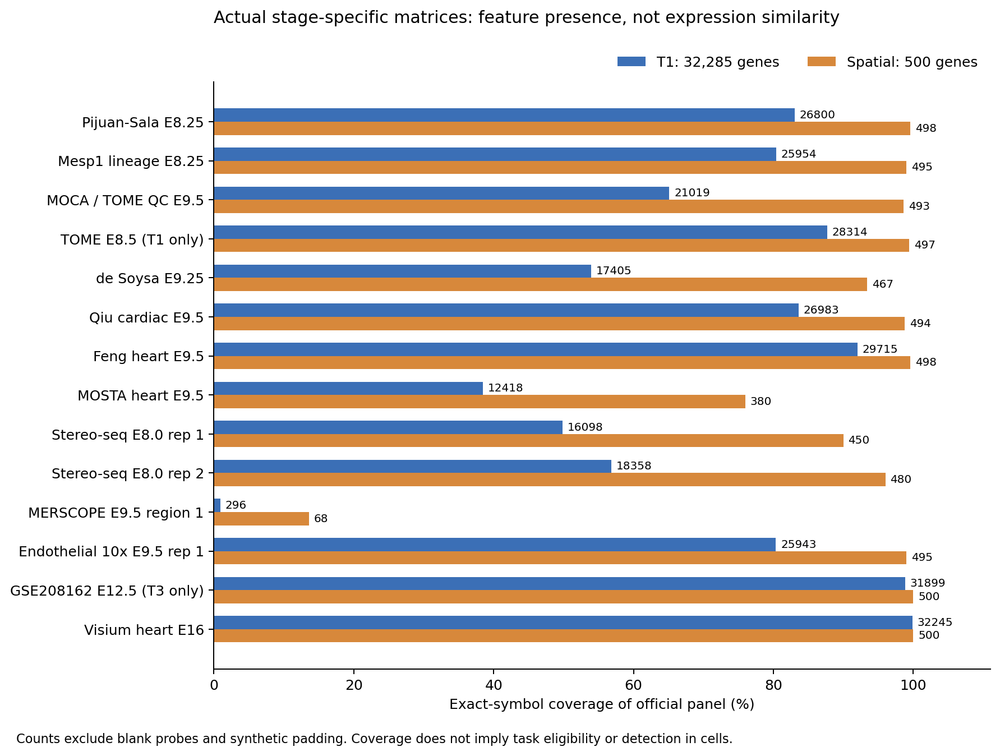
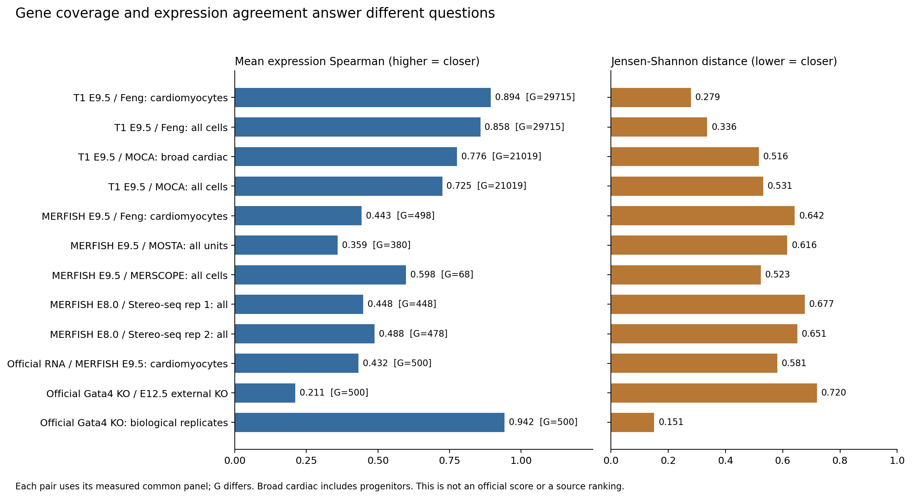

# 官方与同任务外部数据的基因面板、表达相似度实测

[GSE342607 · 小鼠胚胎谱系追踪图谱 的六组同日龄对照](../research/vem_source_comparison_v2/README.html#gse342607-comparison)

2026-11-15，在 5090 上完成。两项请求都已处理：本报告回答“外部数据到底有多像官方”，[第二份报告](OFFICIAL_GENE_TARGET_SELECTION_ZH.md)回答“官方如何选择测量基因、阶段目标和敲除靶点”。

**主要结论：外部数据通常能覆盖大部分空间 panel，但这并不代表它们具有相同的表达分布。T1 找到了同阶段、同类型上较接近的外部 RNA；T2 的跨测量差异仍很大；T3 即使同为 Gata4 KO，也不能忽略年龄、Cre、背景等位和对照基因型。**

## 本次实际做了什么

读取 15 个官方文件（9 个训练、6 个已释放验证文件），对照 13 个 VED 来源条目的 30 个外部阶段/样本组，共 45 个分析组。完成 **224 项主比较与对照**，另有固定基因集、同基因三方比较和稳定基因 ID 核对。MOCA/TOME/Qiu 等相关资源不能视为独立生物重复。

验证文件位置仍是 `/home/biocosmosx/work/virtualembryo_cym/official_data_analysis_20261114/raw_validation_release_v1`。这些答案此前已做过诊断，本次用途是描述性研究，不是新盲测。

每组均匀抽最多 4,000 个细胞/细胞核/空间单位；有作者标签时，另按心肌、广义心脏谱系或内皮抽最多 1,600 个。额外类型抽样不混入全部细胞样本。种子固定为 20261115，原始行号与样本 ID 全部保存。

<b>VED-031 · 心脏整体 RNA 时间序列 · E10.5，3个整体RNA重复</b>

<table><thead><tr><th>官方对照</th><th>共同基因</th><th>聚合表达ρ</th><th>各重复ρ</th><th>完整表</th></tr></thead><tbody><tr><td>OFF_T1_E10.5_RNA</td><td>20994</td><td>0.913</td><td>0.910, 0.909, 0.909</td><td><a href="../research/external_E10p5_analysis_20261119/results/OFF_T1_E10.5_RNA__BULK_E105_genes.csv.gz">逐基因表达</a></td></tr><tr><td>OFF_T2_heart_E10.5</td><td>493</td><td>0.448</td><td>0.450, 0.445, 0.445</td><td><a href="../research/external_E10p5_analysis_20261119/results/OFF_T2_heart_E10.5__BULK_E105_genes.csv.gz">逐基因表达</a></td></tr></tbody></table>

先在共同基因内各自归一化到10000；官方取细胞均值，bulk取3个重复均值；最后log1p。没有按细胞计算检出或分布距离。

## 1. 基因覆盖：按可用阶段的真实矩阵重算

**验证集补全 · 2026-11-19**

原覆盖图、表达图及源结果表已接回本页原位置。六验证文件的测量轴已复核：[身份与层记录](../research/validation_completion_20261119/public/validation_files.json)。历史表的别名/稳定ID敏感性与主精确符号分析保持分开。

| 实际外部文件/表示 | 对 T1 的精确名称覆盖 | 对 500 空间 panel 的精确名称覆盖 | 稳定 ID 补充核对后的空间覆盖 |
|---|---:|---:|---:|
| Pijuan-Sala E8.25，单细胞 | 26,800/32,285（83.0%） | 498/500（99.6%） | 500/500 |
| Mesp1 谱系 E8.25，单细胞 | 25,954/32,285（80.4%） | 495/500（99.0%） | 未做原生 ID 核对 |
| MOCA/TOME-QC E9.5，细胞核 | 21,019/32,285（65.1%） | 493/500（98.6%） | 496/500 |
| TOME E8.5，细胞核（表达仅用于 T1） | 28,314/32,285（87.7%） | 497/500（99.4%） | 500/500 |
| de Soysa E9.25，单细胞 | 17,405/32,285（53.9%） | 467/500（93.4%） | 未做原生 ID 核对 |
| Qiu 心场 E9.5，细胞核 | 26,983/32,285（83.6%） | 494/500（98.8%） | 500/500 |
| Feng 心脏 E9.5，单细胞 | 29,715/32,285（92.0%） | 498/500（99.6%） | 未做原生 ID 核对 |
| MOSTA 心脏 E9.5，cell-bin | 12,418/32,285（38.5%） | 380/500（76.0%） | 未做原生 ID 核对 |
| Stereo-seq E8.0，重复 1 | 16,098/32,285（49.9%） | 450/500（90.0%） | 未做原生 ID 核对 |
| Stereo-seq E8.0，重复 2 | 18,358/32,285（56.9%） | 480/500（96.0%） | 未做原生 ID 核对 |
| MERSCOPE E9.5，区域 1 | 296/32,285（0.9%） | 68/500（13.6%） | 未做原生 ID 核对 |
| GSE216970 E9.5，内皮富集 | 25,943/32,285（80.4%） | 495/500（99.0%） | 500/500 |
| GSE208162 E12.5（表达仅用于 T3） | 31,899/32,285（98.8%） | 500/500（100.0%） | 未做原生 ID 核对 |
| Visium E16，心脏 spot | 32,245/32,285（99.9%） | 500/500（100.0%） | 未做原生 ID 核对 |

表中覆盖的是**文件的基因轴**，不是“这些基因在每个细胞都被检出”。T1/空间两列是名单核对；不是给每个来源授权跨任务使用。TOME E8.5 表达只作 T1 比较，GSE208162 E12.5 表达只作有特定许可的 T3 比较。

这次纠正了三类容易混淆的数字：

- **MOSTA E9.5 实际是 380/500（76%）**。旧汇总的 491/500 是多阶段合并的覆盖，不能当成允许使用的 E9.5 文件覆盖；本次没有使用受保护的 E11.5 表达。
- **Stereo-seq E8.0 两个重复分别为 450/500、480/500**；若按当前胚胎 test 的 497 列，则是 448/497、478/497。按实际重复计算，比一个全数据集汇总值更有意义。
- **外部 MERSCOPE 315 列里有 19 个 Blank 控制，真正的基因列是 296 个**；与官方 500 面板重合 68 个（13.6%）。同一仪器品牌/同类测量并不意味着同一 panel。

### 一些“缺失”只是命名不同

主分析先固定精确名称匹配；随后用外部原生 Ensembl ID 与现代 10x feature 注释做了补充核对。例如：

| 官方符号 | 外部符号 | 稳定 ID |
|---|---|---|
| Ccn5 | Wisp2 | ENSMUSG00000027656 |
| Cemip2 | Tmem2 | ENSMUSG00000024754 |
| Cnmd | Lect1 | ENSMUSG00000022025 |
| AI646519 | Pax1dt | ENSMUSG00000087521 |
| Pifo | Cimap3 | ENSMUSG00000010136 |

因此 Pijuan 498、TOME 497、Qiu 494、GSE216970 495 的空间覆盖，均可在这份参考 ID 映射下补齐到 **500/500**；MOCA 从 493 补到 496。T1 也受命名影响：例如 Pijuan 从 26,800 补到 28,707，Qiu 从 26,983 补到 28,989。

官方 H5AD 的 var 只有符号，未附对应 Ensembl ID。上述补充是**有外部稳定 ID 支持的敏感性核对**，不是官方发布的 ID 对照表，也没有悄悄改写主分析。没有原生 ID 的来源未强行套别名；特别是不能把每个缺列都当作改名。

明细：[panel_coverage.csv](panel_coverage.csv)、[missing_genes.json](missing_genes.json.gz)、[alias_coverage_sensitivity.csv](alias_coverage_sensitivity.csv)、[alias_examples.csv](alias_examples.csv)。

## 2. 表达相似度：相同基因不等于相同分布

<b>官方 E10.5 × 外部 E10.5：30 组同阶段对照</b>

15 个外部表达对象分别对照官方 T1 和心脏 E10.5。下表为全部采集对象的表达排序与检出率；点击配对编号查看细胞类型、组成、散点和逐基因明细。

<table style="min-width:1100px;width:100%" data-same-stage-overview="true"><thead><tr><th style="white-space:nowrap">配对</th><th style="white-space:nowrap">官方数据</th><th style="white-space:nowrap">外部数据</th><th style="white-space:nowrap">外部日龄</th><th style="white-space:nowrap">外部观测</th><th style="white-space:nowrap">共同基因</th><th style="white-space:nowrap">表达排序ρ</th><th style="white-space:nowrap">检出率差pp</th></tr></thead><tbody><tr><td style="vertical-align:top;white-space:nowrap"><a href="../research/vem_pairwise_similarity_v3/comparison.html?v=e105-same-stage-20261119#pair=X027&group=ALL">X027</a></td><td style="vertical-align:top;white-space:nowrap">T1 E10.5</td><td style="vertical-align:top;min-width:320px">VED-003 · TOME E9.5–E13.5 全胚胎图谱 ＋ VED-008 · MOCA 全胚胎器官发生图谱</td><td style="vertical-align:top;white-space:nowrap">E10.5</td><td style="vertical-align:top;white-space:nowrap">267,994 细胞核</td><td style="vertical-align:top;white-space:nowrap">20,998</td><td style="vertical-align:top;white-space:nowrap">0.869</td><td style="vertical-align:top;white-space:nowrap">10.74</td></tr><tr><td style="vertical-align:top;white-space:nowrap"><a href="../research/vem_pairwise_similarity_v3/comparison.html?v=e105-same-stage-20261119#pair=X021&group=ALL">X021</a></td><td style="vertical-align:top;white-space:nowrap">T1 E10.5</td><td style="vertical-align:top;min-width:320px">VED-007 · Qiu 产前细胞核图谱</td><td style="vertical-align:top;white-space:nowrap">E10.5</td><td style="vertical-align:top;white-space:nowrap">718 细胞核</td><td style="vertical-align:top;white-space:nowrap">27,859</td><td style="vertical-align:top;white-space:nowrap">0.901</td><td style="vertical-align:top;white-space:nowrap">4.81</td></tr><tr><td style="vertical-align:top;white-space:nowrap"><a href="../research/vem_pairwise_similarity_v3/comparison.html?v=e105-same-stage-20261119#pair=X011&group=ALL">X011</a></td><td style="vertical-align:top;white-space:nowrap">T1 E10.5</td><td style="vertical-align:top;min-width:320px">VED-010 · 胚胎与心脏单细胞图谱｜重复1</td><td style="vertical-align:top;white-space:nowrap">E10.5</td><td style="vertical-align:top;white-space:nowrap">21,570 细胞</td><td style="vertical-align:top;white-space:nowrap">25,888</td><td style="vertical-align:top;white-space:nowrap">0.885</td><td style="vertical-align:top;white-space:nowrap">5.32</td></tr><tr><td style="vertical-align:top;white-space:nowrap"><a href="../research/vem_pairwise_similarity_v3/comparison.html?v=e105-same-stage-20261119#pair=X013&group=ALL">X013</a></td><td style="vertical-align:top;white-space:nowrap">T1 E10.5</td><td style="vertical-align:top;min-width:320px">VED-010 · 胚胎与心脏单细胞图谱｜重复2</td><td style="vertical-align:top;white-space:nowrap">E10.5</td><td style="vertical-align:top;white-space:nowrap">21,093 细胞</td><td style="vertical-align:top;white-space:nowrap">25,888</td><td style="vertical-align:top;white-space:nowrap">0.884</td><td style="vertical-align:top;white-space:nowrap">5.36</td></tr><tr><td style="vertical-align:top;white-space:nowrap"><a href="../research/vem_pairwise_similarity_v3/comparison.html?v=e105-same-stage-20261119#pair=X007&group=ALL">X007</a></td><td style="vertical-align:top;white-space:nowrap">T1 E10.5</td><td style="vertical-align:top;min-width:320px">VED-012 · Feng 分心腔单细胞图谱｜C57BL6</td><td style="vertical-align:top;white-space:nowrap">E10.5</td><td style="vertical-align:top;white-space:nowrap">587 细胞</td><td style="vertical-align:top;white-space:nowrap">29,715</td><td style="vertical-align:top;white-space:nowrap">0.917</td><td style="vertical-align:top;white-space:nowrap">4.49</td></tr><tr><td style="vertical-align:top;white-space:nowrap"><a href="../research/vem_pairwise_similarity_v3/comparison.html?v=e105-same-stage-20261119#pair=X009&group=ALL">X009</a></td><td style="vertical-align:top;white-space:nowrap">T1 E10.5</td><td style="vertical-align:top;min-width:320px">VED-012 · Feng 分心腔单细胞图谱｜CD1</td><td style="vertical-align:top;white-space:nowrap">E10.5</td><td style="vertical-align:top;white-space:nowrap">841 细胞</td><td style="vertical-align:top;white-space:nowrap">29,715</td><td style="vertical-align:top;white-space:nowrap">0.908</td><td style="vertical-align:top;white-space:nowrap">6.89</td></tr><tr><td style="vertical-align:top;white-space:nowrap"><a href="../research/vem_pairwise_similarity_v3/comparison.html?v=e105-same-stage-20261119#pair=X019&group=ALL">X019</a></td><td style="vertical-align:top;white-space:nowrap">T1 E10.5</td><td style="vertical-align:top;min-width:320px">VED-014 · Pitx2 缺失心脏单细胞数据 · Control</td><td style="vertical-align:top;white-space:nowrap">E10.5</td><td style="vertical-align:top;white-space:nowrap">12,535 细胞</td><td style="vertical-align:top;white-space:nowrap">18,357</td><td style="vertical-align:top;white-space:nowrap">0.891</td><td style="vertical-align:top;white-space:nowrap">10.26</td></tr><tr><td style="vertical-align:top;white-space:nowrap"><a href="../research/vem_pairwise_similarity_v3/comparison.html?v=e105-same-stage-20261119#pair=X001&group=ALL">X001</a></td><td style="vertical-align:top;white-space:nowrap">T1 E10.5</td><td style="vertical-align:top;min-width:320px">VED-015 · BubR1 缺失心脏单细胞数据 · WT</td><td style="vertical-align:top;white-space:nowrap">E10.5</td><td style="vertical-align:top;white-space:nowrap">13,723 细胞</td><td style="vertical-align:top;white-space:nowrap">32,207</td><td style="vertical-align:top;white-space:nowrap">0.961</td><td style="vertical-align:top;white-space:nowrap">4.00</td></tr><tr><td style="vertical-align:top;white-space:nowrap"><a href="../research/vem_pairwise_similarity_v3/comparison.html?v=e105-same-stage-20261119#pair=X015&group=ALL">X015</a></td><td style="vertical-align:top;white-space:nowrap">T1 E10.5</td><td style="vertical-align:top;min-width:320px">VED-016 · 心脏流出道单细胞数据</td><td style="vertical-align:top;white-space:nowrap">E10.5</td><td style="vertical-align:top;white-space:nowrap">11,480 细胞</td><td style="vertical-align:top;white-space:nowrap">31,974</td><td style="vertical-align:top;white-space:nowrap">0.899</td><td style="vertical-align:top;white-space:nowrap">4.30</td></tr><tr><td style="vertical-align:top;white-space:nowrap"><a href="../research/vem_pairwise_similarity_v3/comparison.html?v=e105-same-stage-20261119#pair=X017&group=ALL">X017</a></td><td style="vertical-align:top;white-space:nowrap">T1 E10.5</td><td style="vertical-align:top;min-width:320px">VED-019 · Osr1 阳性第二心场单细胞数据</td><td style="vertical-align:top;white-space:nowrap">E10.5</td><td style="vertical-align:top;white-space:nowrap">967 细胞</td><td style="vertical-align:top;white-space:nowrap">16,866</td><td style="vertical-align:top;white-space:nowrap">0.869</td><td style="vertical-align:top;white-space:nowrap">7.90</td></tr><tr><td style="vertical-align:top;white-space:nowrap"><a href="../research/vem_pairwise_similarity_v3/comparison.html?v=e105-same-stage-20261119#pair=X023&group=ALL">X023</a></td><td style="vertical-align:top;white-space:nowrap">T1 E10.5</td><td style="vertical-align:top;min-width:320px">VED-029 · CD1 心脏 Visium／Slide-seq 图谱｜重复1</td><td style="vertical-align:top;white-space:nowrap">E10.5</td><td style="vertical-align:top;white-space:nowrap">3,839 bead</td><td style="vertical-align:top;white-space:nowrap">14,488</td><td style="vertical-align:top;white-space:nowrap">0.769</td><td style="vertical-align:top;white-space:nowrap">18.90</td></tr><tr><td style="vertical-align:top;white-space:nowrap"><a href="../research/vem_pairwise_similarity_v3/comparison.html?v=e105-same-stage-20261119#pair=X025&group=ALL">X025</a></td><td style="vertical-align:top;white-space:nowrap">T1 E10.5</td><td style="vertical-align:top;min-width:320px">VED-029 · CD1 心脏 Visium／Slide-seq 图谱｜重复2</td><td style="vertical-align:top;white-space:nowrap">E10.5</td><td style="vertical-align:top;white-space:nowrap">2,396 bead</td><td style="vertical-align:top;white-space:nowrap">14,488</td><td style="vertical-align:top;white-space:nowrap">0.747</td><td style="vertical-align:top;white-space:nowrap">18.92</td></tr><tr><td style="vertical-align:top;white-space:nowrap"><a href="../research/vem_pairwise_similarity_v3/comparison.html?v=e105-same-stage-20261119#pair=X029&group=ALL">X029</a></td><td style="vertical-align:top;white-space:nowrap">T1 E10.5</td><td style="vertical-align:top;min-width:320px">VED-030 · E10.5 心脏 Visium 空间数据</td><td style="vertical-align:top;white-space:nowrap">E10.5</td><td style="vertical-align:top;white-space:nowrap">332 spot</td><td style="vertical-align:top;white-space:nowrap">32,207</td><td style="vertical-align:top;white-space:nowrap">0.901</td><td style="vertical-align:top;white-space:nowrap">11.43</td></tr><tr><td style="vertical-align:top;white-space:nowrap"><a href="../research/vem_pairwise_similarity_v3/comparison.html?v=e105-same-stage-20261119#pair=X003&group=ALL">X003</a></td><td style="vertical-align:top;white-space:nowrap">T1 E10.5</td><td style="vertical-align:top;min-width:320px">VED-033 · 胚胎与成体 DBiT-seq 空间数据｜重复1</td><td style="vertical-align:top;white-space:nowrap">E10.5</td><td style="vertical-align:top;white-space:nowrap">2,306 pixel</td><td style="vertical-align:top;white-space:nowrap">13,590</td><td style="vertical-align:top;white-space:nowrap">0.785</td><td style="vertical-align:top;white-space:nowrap">18.41</td></tr><tr><td style="vertical-align:top;white-space:nowrap"><a href="../research/vem_pairwise_similarity_v3/comparison.html?v=e105-same-stage-20261119#pair=X005&group=ALL">X005</a></td><td style="vertical-align:top;white-space:nowrap">T1 E10.5</td><td style="vertical-align:top;min-width:320px">VED-033 · 胚胎与成体 DBiT-seq 空间数据｜重复2</td><td style="vertical-align:top;white-space:nowrap">E10.5</td><td style="vertical-align:top;white-space:nowrap">2,130 pixel</td><td style="vertical-align:top;white-space:nowrap">13,789</td><td style="vertical-align:top;white-space:nowrap">0.764</td><td style="vertical-align:top;white-space:nowrap">17.69</td></tr><tr><td style="vertical-align:top;white-space:nowrap"><a href="../research/vem_pairwise_similarity_v3/comparison.html?v=e105-same-stage-20261119#pair=X028&group=ALL">X028</a></td><td style="vertical-align:top;white-space:nowrap">T2 心脏 E10.5</td><td style="vertical-align:top;min-width:320px">VED-003 · TOME E9.5–E13.5 全胚胎图谱 ＋ VED-008 · MOCA 全胚胎器官发生图谱</td><td style="vertical-align:top;white-space:nowrap">E10.5</td><td style="vertical-align:top;white-space:nowrap">267,994 细胞核</td><td style="vertical-align:top;white-space:nowrap">493</td><td style="vertical-align:top;white-space:nowrap">0.312</td><td style="vertical-align:top;white-space:nowrap">7.41</td></tr><tr><td style="vertical-align:top;white-space:nowrap"><a href="../research/vem_pairwise_similarity_v3/comparison.html?v=e105-same-stage-20261119#pair=X022&group=ALL">X022</a></td><td style="vertical-align:top;white-space:nowrap">T2 心脏 E10.5</td><td style="vertical-align:top;min-width:320px">VED-007 · Qiu 产前细胞核图谱</td><td style="vertical-align:top;white-space:nowrap">E10.5</td><td style="vertical-align:top;white-space:nowrap">718 细胞核</td><td style="vertical-align:top;white-space:nowrap">497</td><td style="vertical-align:top;white-space:nowrap">0.369</td><td style="vertical-align:top;white-space:nowrap">11.00</td></tr><tr><td style="vertical-align:top;white-space:nowrap"><a href="../research/vem_pairwise_similarity_v3/comparison.html?v=e105-same-stage-20261119#pair=X012&group=ALL">X012</a></td><td style="vertical-align:top;white-space:nowrap">T2 心脏 E10.5</td><td style="vertical-align:top;min-width:320px">VED-010 · 胚胎与心脏单细胞图谱｜重复1</td><td style="vertical-align:top;white-space:nowrap">E10.5</td><td style="vertical-align:top;white-space:nowrap">21,570 细胞</td><td style="vertical-align:top;white-space:nowrap">494</td><td style="vertical-align:top;white-space:nowrap">0.424</td><td style="vertical-align:top;white-space:nowrap">7.31</td></tr><tr><td style="vertical-align:top;white-space:nowrap"><a href="../research/vem_pairwise_similarity_v3/comparison.html?v=e105-same-stage-20261119#pair=X014&group=ALL">X014</a></td><td style="vertical-align:top;white-space:nowrap">T2 心脏 E10.5</td><td style="vertical-align:top;min-width:320px">VED-010 · 胚胎与心脏单细胞图谱｜重复2</td><td style="vertical-align:top;white-space:nowrap">E10.5</td><td style="vertical-align:top;white-space:nowrap">21,093 细胞</td><td style="vertical-align:top;white-space:nowrap">494</td><td style="vertical-align:top;white-space:nowrap">0.425</td><td style="vertical-align:top;white-space:nowrap">7.30</td></tr><tr><td style="vertical-align:top;white-space:nowrap"><a href="../research/vem_pairwise_similarity_v3/comparison.html?v=e105-same-stage-20261119#pair=X008&group=ALL">X008</a></td><td style="vertical-align:top;white-space:nowrap">T2 心脏 E10.5</td><td style="vertical-align:top;min-width:320px">VED-012 · Feng 分心腔单细胞图谱｜C57BL6</td><td style="vertical-align:top;white-space:nowrap">E10.5</td><td style="vertical-align:top;white-space:nowrap">587 细胞</td><td style="vertical-align:top;white-space:nowrap">498</td><td style="vertical-align:top;white-space:nowrap">0.454</td><td style="vertical-align:top;white-space:nowrap">11.72</td></tr><tr><td style="vertical-align:top;white-space:nowrap"><a href="../research/vem_pairwise_similarity_v3/comparison.html?v=e105-same-stage-20261119#pair=X010&group=ALL">X010</a></td><td style="vertical-align:top;white-space:nowrap">T2 心脏 E10.5</td><td style="vertical-align:top;min-width:320px">VED-012 · Feng 分心腔单细胞图谱｜CD1</td><td style="vertical-align:top;white-space:nowrap">E10.5</td><td style="vertical-align:top;white-space:nowrap">841 细胞</td><td style="vertical-align:top;white-space:nowrap">498</td><td style="vertical-align:top;white-space:nowrap">0.423</td><td style="vertical-align:top;white-space:nowrap">13.48</td></tr><tr><td style="vertical-align:top;white-space:nowrap"><a href="../research/vem_pairwise_similarity_v3/comparison.html?v=e105-same-stage-20261119#pair=X020&group=ALL">X020</a></td><td style="vertical-align:top;white-space:nowrap">T2 心脏 E10.5</td><td style="vertical-align:top;min-width:320px">VED-014 · Pitx2 缺失心脏单细胞数据 · Control</td><td style="vertical-align:top;white-space:nowrap">E10.5</td><td style="vertical-align:top;white-space:nowrap">12,535 细胞</td><td style="vertical-align:top;white-space:nowrap">477</td><td style="vertical-align:top;white-space:nowrap">0.476</td><td style="vertical-align:top;white-space:nowrap">13.88</td></tr><tr><td style="vertical-align:top;white-space:nowrap"><a href="../research/vem_pairwise_similarity_v3/comparison.html?v=e105-same-stage-20261119#pair=X002&group=ALL">X002</a></td><td style="vertical-align:top;white-space:nowrap">T2 心脏 E10.5</td><td style="vertical-align:top;min-width:320px">VED-015 · BubR1 缺失心脏单细胞数据 · WT</td><td style="vertical-align:top;white-space:nowrap">E10.5</td><td style="vertical-align:top;white-space:nowrap">13,723 细胞</td><td style="vertical-align:top;white-space:nowrap">500</td><td style="vertical-align:top;white-space:nowrap">0.427</td><td style="vertical-align:top;white-space:nowrap">7.08</td></tr><tr><td style="vertical-align:top;white-space:nowrap"><a href="../research/vem_pairwise_similarity_v3/comparison.html?v=e105-same-stage-20261119#pair=X016&group=ALL">X016</a></td><td style="vertical-align:top;white-space:nowrap">T2 心脏 E10.5</td><td style="vertical-align:top;min-width:320px">VED-016 · 心脏流出道单细胞数据</td><td style="vertical-align:top;white-space:nowrap">E10.5</td><td style="vertical-align:top;white-space:nowrap">11,480 细胞</td><td style="vertical-align:top;white-space:nowrap">500</td><td style="vertical-align:top;white-space:nowrap">0.493</td><td style="vertical-align:top;white-space:nowrap">11.09</td></tr><tr><td style="vertical-align:top;white-space:nowrap"><a href="../research/vem_pairwise_similarity_v3/comparison.html?v=e105-same-stage-20261119#pair=X018&group=ALL">X018</a></td><td style="vertical-align:top;white-space:nowrap">T2 心脏 E10.5</td><td style="vertical-align:top;min-width:320px">VED-019 · Osr1 阳性第二心场单细胞数据</td><td style="vertical-align:top;white-space:nowrap">E10.5</td><td style="vertical-align:top;white-space:nowrap">967 细胞</td><td style="vertical-align:top;white-space:nowrap">475</td><td style="vertical-align:top;white-space:nowrap">0.480</td><td style="vertical-align:top;white-space:nowrap">7.93</td></tr><tr><td style="vertical-align:top;white-space:nowrap"><a href="../research/vem_pairwise_similarity_v3/comparison.html?v=e105-same-stage-20261119#pair=X024&group=ALL">X024</a></td><td style="vertical-align:top;white-space:nowrap">T2 心脏 E10.5</td><td style="vertical-align:top;min-width:320px">VED-029 · CD1 心脏 Visium／Slide-seq 图谱｜重复1</td><td style="vertical-align:top;white-space:nowrap">E10.5</td><td style="vertical-align:top;white-space:nowrap">3,839 bead</td><td style="vertical-align:top;white-space:nowrap">380</td><td style="vertical-align:top;white-space:nowrap">0.389</td><td style="vertical-align:top;white-space:nowrap">7.43</td></tr><tr><td style="vertical-align:top;white-space:nowrap"><a href="../research/vem_pairwise_similarity_v3/comparison.html?v=e105-same-stage-20261119#pair=X026&group=ALL">X026</a></td><td style="vertical-align:top;white-space:nowrap">T2 心脏 E10.5</td><td style="vertical-align:top;min-width:320px">VED-029 · CD1 心脏 Visium／Slide-seq 图谱｜重复2</td><td style="vertical-align:top;white-space:nowrap">E10.5</td><td style="vertical-align:top;white-space:nowrap">2,396 bead</td><td style="vertical-align:top;white-space:nowrap">380</td><td style="vertical-align:top;white-space:nowrap">0.389</td><td style="vertical-align:top;white-space:nowrap">7.53</td></tr><tr><td style="vertical-align:top;white-space:nowrap"><a href="../research/vem_pairwise_similarity_v3/comparison.html?v=e105-same-stage-20261119#pair=X030&group=ALL">X030</a></td><td style="vertical-align:top;white-space:nowrap">T2 心脏 E10.5</td><td style="vertical-align:top;min-width:320px">VED-030 · E10.5 心脏 Visium 空间数据</td><td style="vertical-align:top;white-space:nowrap">E10.5</td><td style="vertical-align:top;white-space:nowrap">332 spot</td><td style="vertical-align:top;white-space:nowrap">500</td><td style="vertical-align:top;white-space:nowrap">0.545</td><td style="vertical-align:top;white-space:nowrap">26.06</td></tr><tr><td style="vertical-align:top;white-space:nowrap"><a href="../research/vem_pairwise_similarity_v3/comparison.html?v=e105-same-stage-20261119#pair=X004&group=ALL">X004</a></td><td style="vertical-align:top;white-space:nowrap">T2 心脏 E10.5</td><td style="vertical-align:top;min-width:320px">VED-033 · 胚胎与成体 DBiT-seq 空间数据｜重复1</td><td style="vertical-align:top;white-space:nowrap">E10.5</td><td style="vertical-align:top;white-space:nowrap">2,306 pixel</td><td style="vertical-align:top;white-space:nowrap">419</td><td style="vertical-align:top;white-space:nowrap">0.391</td><td style="vertical-align:top;white-space:nowrap">5.88</td></tr><tr><td style="vertical-align:top;white-space:nowrap"><a href="../research/vem_pairwise_similarity_v3/comparison.html?v=e105-same-stage-20261119#pair=X006&group=ALL">X006</a></td><td style="vertical-align:top;white-space:nowrap">T2 心脏 E10.5</td><td style="vertical-align:top;min-width:320px">VED-033 · 胚胎与成体 DBiT-seq 空间数据｜重复2</td><td style="vertical-align:top;white-space:nowrap">E10.5</td><td style="vertical-align:top;white-space:nowrap">2,130 pixel</td><td style="vertical-align:top;white-space:nowrap">406</td><td style="vertical-align:top;white-space:nowrap">0.375</td><td style="vertical-align:top;white-space:nowrap">5.88</td></tr></tbody></table>

上表沿用A10/A11的共同基因内log1p均值口径。下面保留原均值份额／JS口径的结果，分别阅读。

**原均值份额口径的邻近阶段对照**

<table style="min-width:750px;width:100%"><thead><tr><th style="white-space:nowrap;min-width:70px">官方验证</th><th>外部背景</th><th>共同基因</th><th>原口径ρ</th><th>原口径JS</th><th>适用条件</th></tr></thead><tbody><tr><td style="white-space:nowrap;min-width:70px">T1 E10.5</td><td>VED-003 · TOME E9.5–E13.5 全胚胎图谱 E9.5</td><td>21019</td><td>0.742</td><td>0.497</td><td>不同阶段背景</td></tr><tr><td style="white-space:nowrap;min-width:70px">T1 E10.5</td><td>VED-007 · Qiu 产前细胞核图谱 E9.5</td><td>26983</td><td>0.764</td><td>0.526</td><td>不同阶段背景</td></tr><tr><td style="white-space:nowrap;min-width:70px">T1 E10.5</td><td>VED-012 · Feng 分心腔单细胞图谱 E9.5</td><td>29715</td><td>0.808</td><td>0.379</td><td>不同阶段背景</td></tr><tr><td style="white-space:nowrap;min-width:70px">胚胎 E7.5</td><td>VED-001 · Pijuan-Sala 早期全胚胎图谱 E7.25</td><td>495</td><td>0.350</td><td>0.768</td><td>不同阶段背景</td></tr><tr><td style="white-space:nowrap;min-width:70px">胚胎 E7.5</td><td>VED-002 · Mesp1 早期心脏谱系图谱 E7.25</td><td>492</td><td>0.357</td><td>0.750</td><td>不同阶段背景</td></tr><tr><td style="white-space:nowrap;min-width:70px">胚胎 E7.5</td><td>VED-001 · Pijuan-Sala 早期全胚胎图谱 E8.0</td><td>495</td><td>0.427</td><td>0.727</td><td>不同阶段背景</td></tr><tr><td style="white-space:nowrap;min-width:70px">胚胎 E7.5</td><td>VED-020 · Stereo-seq 胚胎三维重建图谱 E8.0 · 重复1</td><td>448</td><td>0.304</td><td>0.692</td><td>不同阶段背景</td></tr><tr><td style="white-space:nowrap;min-width:70px">胚胎 E7.5</td><td>VED-020 · Stereo-seq 胚胎三维重建图谱 E8.0 · 重复2</td><td>478</td><td>0.309</td><td>0.670</td><td>不同阶段背景</td></tr><tr><td style="white-space:nowrap;min-width:70px">心脏 E8.5</td><td>VED-001 · Pijuan-Sala 早期全胚胎图谱 E8.25</td><td>498</td><td>0.553</td><td>0.697</td><td>不同阶段背景</td></tr><tr><td style="white-space:nowrap;min-width:70px">心脏 E8.5</td><td>VED-002 · Mesp1 早期心脏谱系图谱 E8.25</td><td>495</td><td>0.559</td><td>0.662</td><td>不同阶段背景</td></tr><tr><td style="white-space:nowrap;min-width:70px">心脏 E8.5</td><td>VED-006 · de Soysa 早期心脏图谱 E8.25</td><td>467</td><td>0.594</td><td>0.619</td><td>不同阶段背景</td></tr><tr><td style="white-space:nowrap;min-width:70px">心脏 E8.5</td><td>VED-007 · Qiu 产前细胞核图谱 E8.75</td><td>494</td><td>0.288</td><td>0.759</td><td>不同阶段背景</td></tr><tr><td style="white-space:nowrap;min-width:70px">心脏 E8.5</td><td>VED-007 · Qiu 产前细胞核图谱 E8.75</td><td>494</td><td>0.262</td><td>0.710</td><td>不同阶段背景</td></tr><tr><td style="white-space:nowrap;min-width:70px">心脏 E10.5</td><td>VED-012 · Feng 分心腔单细胞图谱 E9.5</td><td>498</td><td>0.252</td><td>0.762</td><td>不同阶段背景</td></tr><tr><td style="white-space:nowrap;min-width:70px">心脏 E10.5</td><td>VED-007 · Qiu 产前细胞核图谱 E9.5</td><td>494</td><td>0.154</td><td>0.779</td><td>不同阶段背景</td></tr><tr><td style="white-space:nowrap;min-width:70px">心脏 E10.5</td><td>VED-009 · MOSTA 心脏空间图谱 E9.5</td><td>380</td><td>0.237</td><td>0.677</td><td>不同阶段背景</td></tr><tr><td style="white-space:nowrap;min-width:70px">Gata4 KO 重复1</td><td>VED-018 · Cdh5-CreER Gata4 缺失心室数据 E12.5</td><td>500</td><td>0.211</td><td>0.720</td><td>历史专项许可、基因型/日龄不匹配</td></tr><tr><td style="white-space:nowrap;min-width:70px">Gata4 KO 重复1</td><td>VED-018 · Cdh5-CreER Gata4 缺失心室数据 E12.5</td><td>500</td><td>0.226</td><td>0.726</td><td>历史专项许可、基因型/日龄不匹配</td></tr><tr><td style="white-space:nowrap;min-width:70px">Gata4 KO 重复2</td><td>VED-018 · Cdh5-CreER Gata4 缺失心室数据 E12.5</td><td>500</td><td>0.211</td><td>0.704</td><td>历史专项许可、基因型/日龄不匹配</td></tr><tr><td style="white-space:nowrap;min-width:70px">Gata4 KO 重复2</td><td>VED-018 · Cdh5-CreER Gata4 缺失心室数据 E12.5</td><td>500</td><td>0.223</td><td>0.714</td><td>历史专项许可、基因型/日龄不匹配</td></tr></tbody></table>

本表复用11月15日结果，均值先归一化为份额，且ρ使用至少一侧1%检出的基因；与A10/A11的log1p均值口径不同，不混合排名。[所有涉及验证文件的历史行](validation_similarity.csv)。

对每一对数据，只使用共同的实测基因，先将每个细胞的线性表达在该共同面板上归一化至和为 1，再取各基因的细胞均值。这里的“表达 Spearman”比较这些均值的排序，使用至少在任一侧 1% 抽样细胞中检出的基因，避免大量双方不表达的基因把相关性抬高。JS 距离比较整个共同面板上的平均表达份额；0 表示相同，越大差异越大。

**ρ 不是相似百分比，JS 也不是官方分数。** 两个指标可能给出不同次序，不合成一个总分；本次没有拟合预测模型或据此宣称官方得分会提高。

| 对照 | 使用的共同基因数 | 表达 Spearman ρ | JS 距离 |
|---|---:|---:|---:|
| T1 E9.5 ↔ Feng E9.5，全部细胞 | 29,715 | 0.858 | 0.336 |
| T1 E9.5 ↔ Feng E9.5，心肌细胞 | 29,715 | 0.894 | 0.279 |
| T1 E8.5 ↔ Pijuan E8.5，心肌细胞 | 26,800 | 0.819 | 0.392 |
| T1 E8.5 ↔ TOME E8.5，广义心脏谱系 | 28,314 | 0.840 | 0.482 |
| T2 胚胎 E8.0 ↔ Stereo-seq 重复 1，全部单位 | 448 | 0.448 | 0.677 |
| T2 胚胎 E8.0 ↔ Stereo-seq 重复 2，全部单位 | 478 | 0.488 | 0.651 |
| T2 心脏 E9.5 ↔ Feng E9.5，心肌细胞 | 498 | 0.443 | 0.642 |
| T2 心脏 E9.5 ↔ MOSTA E9.5，全部单位 | 380 | 0.359 | 0.616 |
| T2 心脏 E9.5 ↔ MERSCOPE E9.5 区域 1 | 68 | 0.598 | 0.523 |
| 官方 Gata4 KO1 ↔ 外部 E12.5 Gata4 KO1 | 500 | 0.211 | 0.720 |
| 官方 Gata4 KO1 ↔ 官方 KO2，生物重复 | 500 | 0.942 | 0.151 |

各对共同基因不同，因此此表不能直接当作外部数据排行榜。广义心脏谱系包含心场/前体，与成熟心肌标签不完全等价；全部细胞比较还混合取材和组成差异。

### 最重要的公平对照：三方固定同一组基因

把官方 E9.5 核 RNA、官方 E9.5 MERFISH、Feng E9.5 都限制在**同一批 498 个共同基因、同为心肌细胞**；再统一用三方至少一方达到 1% 检出的 **437 个基因**计算相关性：

| 同基因、同名阶段、同类型比较 | Spearman ρ | JS（498 基因） |
|---|---:|---:|
| 官方 T1 核 RNA ↔ Feng RNA | 0.792 | 0.411 |
| 官方 MERFISH ↔ Feng RNA | 0.479 | 0.642 |
| 官方 T1 核 RNA ↔ 官方 MERFISH | 0.454 | 0.581 |

这排除了“只是 T1 用三万基因、T2 用五百基因”这一解释。**即使同一官方实验团队、同阶段、同粗类型，两种测量的平均基因份额也差异明显。** 官方明确说明两种实验不来自同一批胚胎；细胞核与分割细胞、取材、测量、注释及群内状态都可能参与，不能将差异单独归因于平台。

该三方样本中，每个心肌单位在 498 基因上的检出基因数中位数为：官方核 RNA 99、MERFISH 37、Feng 103。这是观察到的检出模式差异，不是基因轴是否存在的差异。

其他固定交集核对也保留主要现象：T1 多来源共同 15,388 基因上，官方–Feng 心肌 ρ=0.893；E8.0 胚胎各来源统一 448 基因后，官方–Stereo 两重复 ρ=0.448/0.482。详见 [fixed_panel_sensitivity.csv](fixed_panel_sensitivity.csv)、[same_panel_control.csv](same_panel_control.csv)。

## 3. 分任务怎么理解

**验证集补全 · 2026-11-19**

六份验证已在历史224项结果中；T1、胚胎、两种心脏验证分别显示于上表，Gata4重复不合并。专项许可来源 VED-018 · Cdh5-CreER Gata4 缺失心室数据 的E12.5背景仍不满足官方E8.75的Cre、等位背景和对照条件，不能称匹配验证。

### T1

Feng E9.5 是本轮同阶段、同细胞大类的清晰对照：心肌 705 个、内皮 70 个，因此心肌证据比小样本内皮更稳。官方是 Black Swiss 的 Multiome 核 RNA，Feng E9.5 是 CD1；两者不是完全匹配的采样。

Pijuan E8.5 心肌与官方 T1 的 ρ=0.819；TOME E8.5 广义心脏谱系为 0.840，说明外部早期心脏 RNA 有可用的相近表达信息。MOCA 整胚全部细胞 ρ=0.725，按广义心脏谱系提高至 0.776，也提醒我们不能把整胚组成直接照搬到官方心脏周围取材。

这些是**状态相似性**，没有验证“从早期推到 E12.5 的发育变化是否正确”。外部 E14.5/E16 对 E10.5 的对照在完整结果中保留为明确的阶段错位诊断，不能称作同阶段验证。

### T2 胚胎

E8.0 Stereo-seq 两重复对官方的 ρ=0.448/0.488，而两个外部重复彼此 ρ=0.939。官方 E8.0 随机分半的 ρ=0.992。这说明主要差距远超过本次抽样噪声，但不能只凭这些对照把原因分解为平台、区域或标签差异。

还要注意官方最新具体协议：E8.0 只收从卵黄囊–胚胎边界到心月牙消失层面的切片，不能把“whole embryo setting”理解成与外部整胚采样严格相同。Stereo-seq 的标签也有参考映射成分，不是独立的细胞类型真值。

E7.25 官方的检出较浅，按 497 面板每个单位约 16–17 个基因；对 Pijuan 同名阶段的 ρ 只有 0.157。这种低检出和区域差异需要先解释，不能因覆盖接近 100% 就把外部表达直接作为官方答案的替身。

### T2 心脏

RNA 数据很容易在符号/ID 上覆盖整个 500 panel，实际表达份额仍有明显差距。MOSTA E9.5 保留空间信息，却只剩 380 个共同基因，而且单位是 cell-bin；其相对官方 ρ=0.359，不能简单认为“空间数据必然更像空间数据”。

MERSCOPE E9.5 区域 1 的 ρ=0.598 是在 68 个共同基因上得到的；区域 0 是 0.267。少量精选基因、不同区域和 500 基因全局分布不是同一个问题，因此不能凭 0.598 将它列为最佳全 panel 教师。

3D 坐标属于各胚胎局部坐标系，本轮未做跨文件最近邻、未宣称外部位置更接近真实解剖。MOSTA 的 X 数值呈计数兼容，但其归一化说明未完全确认，相关结果应保留这项限制。

### T3

有组织方专项许可的 GSE208162 覆盖 500/500，但它是 **E12.5、Cdh5-CreERT2、KO 对 Het**；官方是 **E8.75、Mesp1-Cre、Gata4 F/F; Gata6 F/+、KO 对 WT**。外部 KO 对官方 KO 的全部细胞表达 ρ 仅 0.211–0.226；官方两 KO 生物重复之间为 0.942，心肌为 0.957。

额外做了相对表达响应的描述性核对：外部 KO–Het 对官方 KO–WT，ρ=-0.094，符号一致率 43.3%（478 个有检出支持的基因，份额加 1e-6 后算 log2 比值）。这是被年龄、驱动、背景、组成和对照类别共同混杂的结果，**不能据此断言 Gata4 机制相反**；它说明这份外部数据不能不经验证就替代官方扰动响应。

## 4. 官方“怎么选基因和靶点”的关键答案

- T1 是 RNA 全转录组 32,285 列，不是预挑 500 marker；官方本日协议明确测量对象为细胞核，释放的是 Multiome 的 RNA 通道。
- T2/T3 的 500 基因设计目标是覆盖心脏及周围细胞类型；目前公开了覆盖目标，没有逐基因选择阈值或探针设计表。
- 赛道最终提交 panel 再取相关阶段的有序交集，所以胚胎训练/旧提交为 498，E7.5 真值文件为 500，当前 test 要求 497。
- T1/T2 的预测目标按时间外推/插值切分；T3 是 Mab21l2 训练、Gata4 验证、β-catenin 测试，后者更广泛、作用更分散。
- **Ctnnb1 不在 500 panel 内**，但在 T1 全转录组内。敲除靶点与测量读出基因不是同一个集合。

详细基因型、阶段表、官方原文和未公开的信息见 [OFFICIAL_GENE_TARGET_SELECTION_ZH.md](OFFICIAL_GENE_TARGET_SELECTION_ZH.md)。新协议还说明 Casp4/Pnliprp1 在最早两个阶段是表达过低未检出，设计 panel 本身并未改变；AI646519 缺列的具体原因未公开到同样程度。

## 5. 这轮证据支持的下一步

先统一可信基因 ID 和计数语义，再按阶段与细胞大类建立对照。T1 可以优先用 Feng/Pijuan/TOME 的匹配群体研究生物状态；T2 应先解释官方 RNA 与 MERFISH 的检出/表达差异，外部 RNA 的绝对均值不宜直接移植；T3 先把同阶段官方 WT/KO 和两个 KO 重复当作响应与噪声参照。

本轮没有证明任何外部来源能提升官方预测成绩，也没有验证完整单细胞联合分布、空间绑定或未来发育动力学。以往模型负例和来源隔离记录均保持不变。

## 6. 复核、可复现文件与限制

- 独立复算全部 224 项主比较的 Spearman/JS，最大数值偏差 2.7e-14；6 个原始 H5AD 的行回读与投影结果一致，45 组矩阵和抽样/阶段检查通过。
- 原始 counts 优先使用已记录的 counts/raw 层；T1/Pijuan/de Soysa 的 expm1 结果只称线性归一化表达，不伪称 UMI counts。共同 panel 归一化不消除 dropout、捕获效率或组成差异。
- 原始输入 SHA、矩阵轴、样本行号、作者标签和映射均保留。原轮次的阶段范围见原始证据；本页已补E10.5同阶段对照。
- ρ 的技术分半对照不是独立胚胎；跨来源的多个条目也不是多个独立研究。这里只报告描述性数值，不用细胞数制造生物学显著性。

主要文件：[similarity.csv](similarity.csv)、[cohort_summary.csv](cohort_summary.csv)、[catalog.json](catalog.json)、[sources.json](sources.json)、[AUDIT.json](AUDIT.json)。各 pair 的完整基因均值/检出率在 `gene_profiles/`；抽样矩阵、原始行号与样本 ID 在 `cohorts/`。

复现入口：`extract.py` → `curate_metadata.py` → `compare.py` → `same_panel_control.py` / `alias_check.py` → `audit.py` → `make_plots.py` → `write_report.py`。使用 `/home/biocosmosx/miniconda3/envs/model_py310/bin/python`。首次提取的精确脚本另存 `extract_at_run.py`，与启动时 SHA 一致；后续修改只将新核验的官方核 RNA/取材元数据写入清单，未修改矩阵。

官方来源：[Data](https://virtualembryo.ai/challenge/data)、[Data Protocol](https://virtualembryo.ai/challenge/data-protocol)。所有新产物均在本目录，未覆盖历史实验或同行文件。
