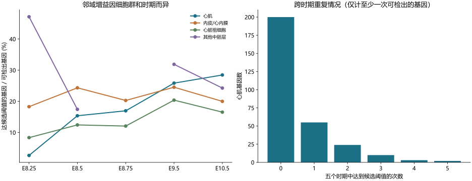

# 500 基因邻域分析：哪些基因真的获得额外解释？

这是一轮探索性扩展，回答“邻域信息是否能解释四个结构标志基因之外的表达差异”。研究了五个时期、四类细胞；其中 E8.75 的其他中胚层少于 250 个细胞，未纳入拟合。其余 19 个时期×类型组合都评估了面板全部 500 个基因。每个基因都得到空间块留出的真实邻域增益和一次分层打乱邻域对照。

## 结果

**验证集补全 · 2026-11-19**

验证阶段已在原9500行扫描中。本次复用如下原表行，没有重复运行邻域回归。

<table style="min-width:625px;width:100%"><thead><tr><th style="white-space:nowrap;min-width:70px">阶段</th><th>类群</th><th>观测数</th><th>合格基因</th><th>原阈值下候选数</th></tr></thead><tbody><tr><td style="white-space:nowrap;min-width:70px">E8.5</td><td>Cardiomyocyte</td><td>1919</td><td>221</td><td>34</td></tr><tr><td style="white-space:nowrap;min-width:70px">E10.5</td><td>Cardiomyocyte</td><td>3000</td><td>137</td><td>39</td></tr><tr><td style="white-space:nowrap;min-width:70px">E8.5</td><td>Endothelial/endocardial</td><td>1190</td><td>230</td><td>56</td></tr><tr><td style="white-space:nowrap;min-width:70px">E8.5</td><td>Cardiac progenitor/heart field</td><td>3000</td><td>225</td><td>28</td></tr><tr><td style="white-space:nowrap;min-width:70px">E8.5</td><td>Other mesoderm</td><td>2264</td><td>195</td><td>34</td></tr><tr><td style="white-space:nowrap;min-width:70px">E10.5</td><td>Endothelial/endocardial</td><td>3000</td><td>150</td><td>30</td></tr><tr><td style="white-space:nowrap;min-width:70px">E10.5</td><td>Cardiac progenitor/heart field</td><td>3000</td><td>133</td><td>22</td></tr><tr><td style="white-space:nowrap;min-width:70px">E10.5</td><td>Other mesoderm</td><td>3000</td><td>136</td><td>33</td></tr></tbody></table>

这是同标本二维空间块留出结果；候选数不是提分，也不是官方三维NFS。

**明确发现：**邻域组成能解释一批标志基因之外的表达差异，且这种增量扩展到了内皮、祖细胞和其他中胚层。全 500 基因中有 393 个至少在一个组合检出率达到 5%；其中 236 个在至少一个组合达到邻域候选标准。心肌内共有 90 个非原四标志基因至少一次达标。具体到每个时期的心肌：

| 时期 | 可检出基因 | 邻域候选 | 其中非四标志基因 |
| --- | ---: | ---: | ---: |
| E8.25_late | 264 | 7 | 6 |
| E8.5 | 221 | 34 | 30 |
| E8.75 | 218 | 37 | 34 |
| E9.5 | 147 | 38 | 35 |
| E10.5 | 137 | 39 | 36 |

四类细胞合并后，236 / 500 个面板基因至少一次达到候选阈值，其中 232 个不属于原先四个结构标志基因；142 个非标志基因跨至少两个时期重复，123 个跨至少两类目标细胞重复。覆盖面较广的非标志基因包括：Svep1, Tbx18, Foxf1, Gata4, Lmod1, Col3a1, Cdh5, Aldh1a2, Tnc, H19, Ahnak, Ngfr, Epha4, Nebl, Cacna2d2。这些数值是候选发现数，不是总体可预测基因数。

阈值敏感性：双重增益门槛从 0.005、0.01、0.02 到 0.05 时，至少一次达标的基因数分别为 282, 236, 162, 71。这说明名单大小随效果大小要求改变；连续的增益值比二元名单更适合排序。

左图展示四类细胞在各时期的候选比例；右图显示心肌中达到候选阈值的时期重复次数。柱图仅为描述，不能作为独立胚胎复现证据。

心肌在至少三个时期达到候选阈值的基因：Myl7, Nebl, Ttn, Cacna2d2, Myl4, Aldh1a2, Tbx18, Col1a2, Gpx3, Kcna5, Ezr, Arhgap31, Ankrd1, Svep1, H19。其中部分不是原四个结构标志基因，提示邻域关联具有一定的基因范围，但多为基因和时期特异关系。完整逐基因结果见 [all_gene_neighbour_scan.csv](tables/all_gene_neighbour_scan.csv)，分组汇总见 [all_gene_neighbour_summary.csv](tables/all_gene_neighbour_summary.csv)。

按基因汇总的跨时期和跨细胞类型覆盖情况见 [all_gene_neighbour_gene_breadth.csv](tables/all_gene_neighbour_gene_breadth.csv)。

## 怎么做的

在每张切片内，寻找每个细胞最近的 15 个邻居，计算四类邻居比例：心肌、内皮/心内膜、心脏祖细胞、其他中胚层。每个时期和目标细胞类型最多随机取 3000 个细胞；邻居组成始终从完整标本计算。每个基因、时期和目标细胞类型单独拟合带 L2 约束的线性模型。基线用原始细胞类型、除该目标基因以外的检出基因数及其平方、标准化 XY 二次项和 z 位置；扩展模型再加入四类邻居比例。每次留出一个 XY 象限×z 前后半段空间块。邻域负对照在原始类型×空间块内整行打乱邻居比例。

R² 增量衡量的是同一发布标本内部的条件关联。5% 检出门槛和 0.01 增益门槛是预先定义的实用筛选标准，并非显著性阈值；低于检出门槛的基因仍完整保存在结果表。每时期只有一份发布标本，邻域标签来自实测数据，空间留出块相邻且未设置缓冲区。基因按完整面板扫描属于探索，重复跨时期不等于独立胚胎验证。当前结果没有证明同一回归系数可跨时期迁移，也没有推断邻居造成表达变化。

单个组合的候选比例从心肌 E8.25 的 2.7% 到其他中胚层 E8.25 的 47.1%。后者所属粗类内部可能包含多个不同的解剖群体，值得在更细标签和更强的位置模型下复查。整体上多数可检出基因在单个组合中的增量仍接近零；方法的价值是找到可排序的候选集合，而非对所有基因施加同一个邻域修正。

## 下一步可做什么

优先针对跨时期重复的非标志基因，比较邻域系数方向和量级；用一个时期拟合、另一个时期只检验，同时加入更灵活的位置基线和缓冲区。若效果保持，再考虑用少数共享参数描述更广泛的状态关系。原始分析代码：[all_gene_neighbour.py](src/all_gene_neighbour.py)。
