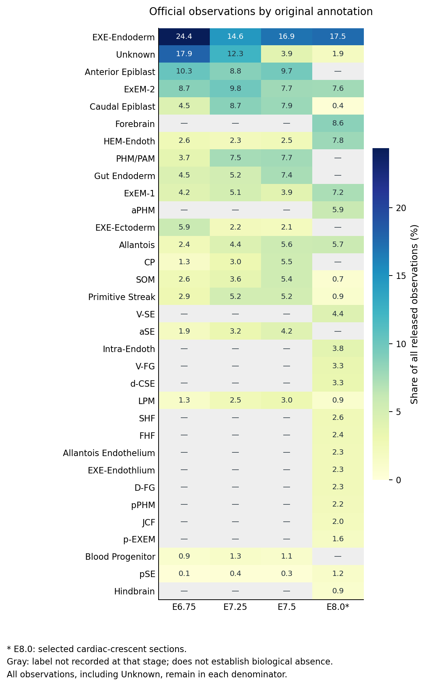
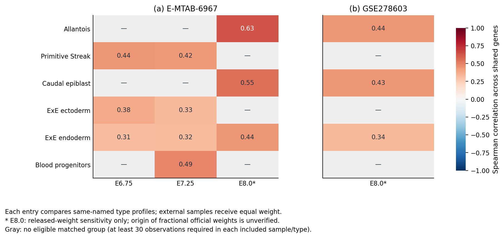
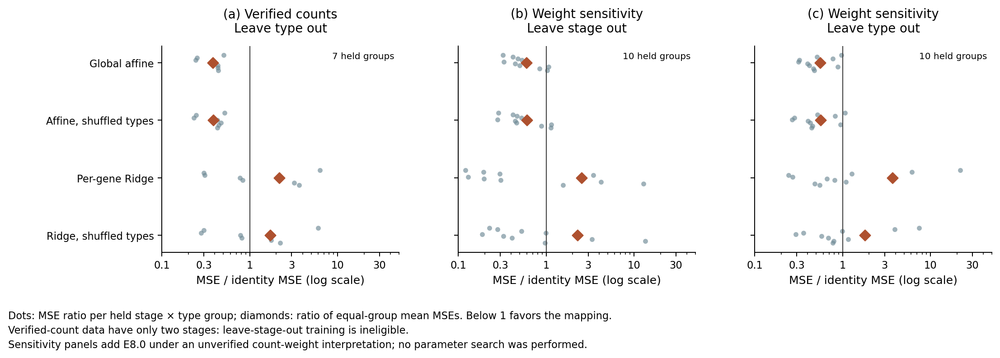

# VEM 早期胚胎先验与数据核对

**阅读入口：[34条具体发现](00_逐条发现_易读版.md) · [搜索与查看单条记录](knowledge.html)。** 每条先说明原研究发现了什么、官方数据看到什么，再解释为什么能或不能比较。原始标签、计算方法和完整证据保留在详情中。

日期：2026-11-16，Asia/Shanghai。第一轮已完成：**34条知识（22条原文陈述、12条原始外部数据复算）均有核对结果或明确的不可检验原因**。先读本页，再从[可检索知识库](knowledge.html)查看单条证据；详细数字在[逐条核对](01_逐条核对.md)、[面板报告](02_面板与可观测性.md)、[跨来源比较](03_跨来源比较.md)。

本轮的直接收获是确定哪些信息可由现有文件回答，以及哪些差异需要先解释数据来源。没有把全部细胞数当生物重复；没有生成比赛预测、评分或提交。

## 一、信息列表：实际发现

1. **面板和取材限制比预想更明确。** 官方500基因设计针对心脏相关及周围细胞；E8.0只含指定心脏新月范围切片。逐基因入选算法仍未公开。因此官方E8.0总体比例不能作为完整胚胎比例；更早阶段精确ROI也未明确。证据：当前[官方协议](https://virtualembryo.ai/challenge/data-protocol)、[固定摘录](provenance/official_protocol_excerpts.json)，强度为官方数据。
2. **比例方向有有限的一致性。** E6.75→E7.25，Primitive Streak官方占比从204/7093（2.88%）变为685/13295（5.15%），增加2.276个百分点；E-MTAB-6967按混合样本等权增加1.459个百分点。EXE-Ectoderm官方减少3.660个百分点，外部减少7.265个百分点。它们只说明给定命名对应下方向一致；外部E6.75只有1个混合样本、E7.25有3个，不能推出分化速度或群体生物学显著性。证据：[D008](knowledge.html#claim=D008)、[D010](knowledge.html#claim=D010)，强度为可复算。
3. **某些肉眼清晰的变化仍不能变成稳定先验。** 官方EXE-Endoderm从24.36%降至14.60%，但外部不同混合样本间方向不一致，D011判为“结果混合”。绝对比例差也不能绕过取材、标签边界和分母问题。证据：[D011](knowledge.html#claim=D011)、[逐样本组成](results/sample_composition.csv)，强度为可复算。
4. **表达轮廓相关，不代表阶段变化一致。** 在496个精确匹配的共同基因上，E6.75/E7.25的7个合格阶段×类群配对Spearman为0.309–0.487；三个可比较类群的阶段变化相关仅0.054–0.085。类型特异性中心化后相关为0.333/0.364，说明共同高表达与细胞类型区分需要分别检查。证据：[相似性](results/cross_source_similarity.csv)、[变化](supplement/stage_change_comparison.csv)、[类型特异性](supplement/type_specificity.csv)，强度为可复算。
5. **具体基因差异可追溯。** E7.25 Primitive Streak的Foxa2在官方685个观测中检出率0%，外部3个混合样本等权26.22%；Lefty2分别5.11%和18.38%。这些差异可能受来源、注释、探针和检测能力影响，尚不能分离各自贡献，不能直接判定原文关于激活过程的陈述错误。EXE-Endoderm的Apoe在官方E6.75/E7.25检出率100.00%/99.95%，对其余标签的AUC为0.947/0.967，只能称与现有注释相符。证据：[逐基因差值](supplement/cross_source_gene_details.csv.gz)、[官方标志统计](supplement/official_marker_profiles.csv)，强度为可复算。
6. **简单仿射能解释一部分尺度差异，但尚不支持稳定生物对应。** 主比较整类型留出时，仿射平均MSE相对identity降低62.00%，打乱类型后也降低61.38%；Ridge反而使平均MSE增加115.54%。主比较只有两个已确认计数阶段，整阶段留出无法满足训练条件。含E8.0的敏感性分析中，仿射整阶段留出改善8/10个组，Allantois和ExE endoderm两个E8.0组变差；Ridge两种留出均不稳定。没有模型通过预定双重留出判据。证据：[逐组误差](results/mapping_folds.csv)、[系数与划分](supplement/affine_coefficients_and_splits.csv)，强度为可复算。
7. **发现两项必须保留的输入异常。** E8.0“counts”层有13,573个非整数非零值，生成步骤未核实；只能确认按文档公式可重现X。E6.75/E7.25仍有448/749个少于5个检出基因的观测，全部属于Unknown，与当前方法页描述不完全一致。主分析保留全部发布观测，过滤敏感性单独报告。证据：[矩阵语义](results/matrix_semantics.json)、[QC敏感性](results/official_qc_sensitivity.csv)，强度为官方数据加可复算。

### 核对结果与输入规模

| 状态 | 条数 |
|---|---|
| 条件不可比 | 20 |
| 面板未覆盖 | 5 |
| 证据不足 | 6 |
| 观测一致 | 2 |
| 结果混合 | 1 |

没有“观测相反”条目不代表所有先验吻合；多数条目当前不具备直接判定条件。原文知识与复算知识的来源依赖已登记，12条复算并不是新增12个独立文献来源。

| 数据 | 阶段/范围 | 观测数 | 独立样本口径 |
|---|---|---|---|
| 官方MERFISH | E6.75 / E7.25 / E7.5 / E8.0 | 7,093 / 13,295 / 11,665 / 31,671 | 4个文件；无个体编号 |
| E-MTAB-6967 | E6.5–E7.25、E8.0–E8.5 | 83,370 | 24个混合样本；共同阶段使用1/3/4个pool |
| GSE278603 | E8.0两份重建数据 | 11,048 / 27,266 | 重建对象；不当作解离单细胞比例 |
| GSE169210 | WT原文与元数据 | 本轮未使用表达矩阵数值 | Et时间与实测E日、metacell与类型对应尚未闭合 |

E-MTAB原始meta中按作者doublet/stripped标记过滤得到116,312个观测，与论文QC总数一致；再按允许日龄筛选得到83,370。没有通过删除缺失注释凑总数，允许阶段QC后缺失注释数实际为0。外部原始矩阵的29,452行是feature/Ensembl行，不能把全部重复symbol视作不同已映射基因。

本轮41个文献需求基因，官方精确匹配提供17个、未提供24个；这不是全体发育基因的覆盖率。5条知识所需基因全部未覆盖。缺列始终记“未提供/未测”，没有补零。完整清单见[逐条可检验性](results/claim_testability.csv)。

### 结果图

## 二、分工与完成记录

| 工作 | 执行与复核 | 实际交付 |
|---|---|---|
| K1原文知识 | 文献子任务 | 22条原文陈述、短摘录、章节定位、来源快照与哈希 |
| K2来源与标签 | 来源子任务 | 官方面板/取材/规则、19行映射证据、GEO来源勘误 |
| K3统计与交付 | 主执行者 | 12条复算先验、4文件核对、跨来源比较、固定映射、数据库与浏览器 |
| K4方法及结果复核 | 独立复核子任务与标量计算 | 启动前问题修复；分母、留出及误差独立核验 |

作业`vem-early-prior-20261116-01`因E8.0整数断言失败，原冻结、源码和收据全部保留。修订作业`vem-early-prior-20261116-02`成功，exit 0；修订只涉及数据语义分层和QC敏感性，34条知识与run01冻结逐字节一致。正式统计在5090单CPU进程执行，约31秒；首轮原始文件哈希耗时另计。仅取回显式列出的摘要与聚合小文件，未镜像原始矩阵。

主核验包含比例独立计数、实际类型×基因标量均值/检测率、sklearn与闭式Ridge对照、逐元素误差、原始MTX允许列对照和受保护列跳过测试。网页34条均可打开，筛选按阶段/类型/基因/来源/状态核验，JavaScript错误为0。图已目视检查；PDF/SVG/PNG并存。

## 三、交接与仍未解决的问题

| 可直接使用的交付 | 入口 |
|---|---|
| 本地检索、关系图、原文与数值返回 | [knowledge.html](knowledge.html) |
| JSONL原记录、CSV、SQLite | [JSONL](knowledge.jsonl) · [CSV](knowledge.csv) · [SQLite](knowledge.sqlite) |
| 带条件和证据的图谱 | [JSON](knowledge_graph.json) · [GraphML](knowledge_graph.graphml) |
| 逐条/面板/跨来源报告 | [01](01_逐条核对.md) · [02](02_面板与可观测性.md) · [03](03_跨来源比较.md) |
| 输入层语义与未闭合来源 | [04_输入语义与缺口](04_输入语义与缺口.md) |
| 复现命令、环境、输入哈希及失败记录 | [REPRODUCE](REPRODUCE.md) · [输入清单](results/input_manifest.json) · [运行环境](results/runtime.json) |
| 审计与勘误 | [验收](DELIVERY_CHECKS.json) · [独立复核](qa/INDEPENDENT_RESULT_CHECKS.json) · [ERRATA](ERRATA.md) |

U1：E8.0半整数值形成步骤、早期QC与发布文件关系；U2：早期ROI、缩写释义、逐细胞注释依据；U3：GSE169210实测采集日与metacell定义对应；U4：面板逐基因入选及探针流程。负责人均为后续来源核对任务，当前保持显式缺口，不通过猜测补齐。GSE278603相关论文直接登录号绑定仍不充分，保留GEO为本轮原始登记来源。

下一步最有价值的是补齐这些具体元数据，让现有条目从不可检验变成可检验。当前结果不足以证明真实分化速度、谱系命运或可独立识别的技术批次效应。没有扩展心脏专项、KO或轨迹重建，没有外发或公开发布资料。
